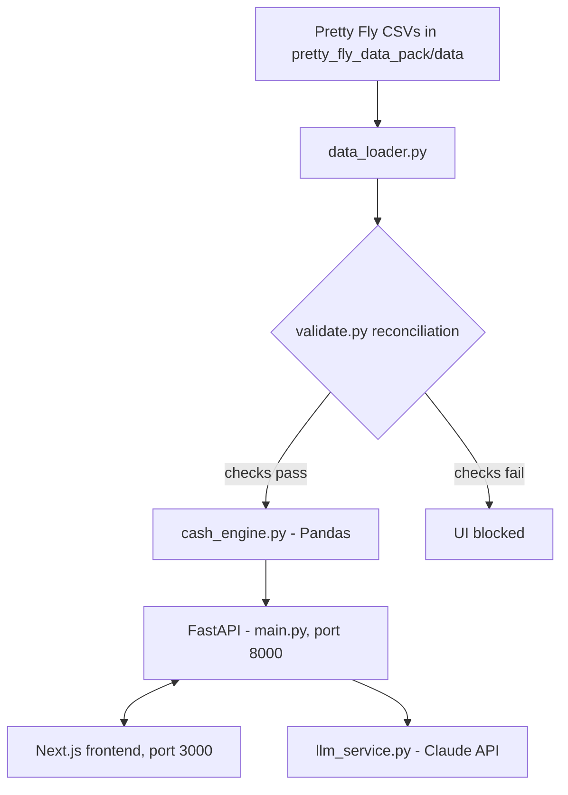

# FlyOS: Intelligent Cash Flow Optimization for E-commerce

[](LICENSE)
[](https://www.python.org/)
[](https://fastapi.tiangolo.com/)
[](https://nextjs.org/)
[](https://www.typescriptlang.org/)
[](https://pandas.pydata.org/)

## Overview

FlyOS is a commerce operating system for direct-to-consumer (DTC) e-commerce businesses. It finds where cash is trapped, such as slow-moving inventory and delayed payments, and turns the findings into ranked actions for recovering it.

It was built for the Wayflyer × Fin Hackathon in London (June 2026). The dataset is fictional and included for demonstration.

## Features

- **Cash leak detection:** analyses 24 months of DTC data to locate where cash is trapped.
- **Ranked recommendations:** evidence-backed actions, prioritised by impact and feasibility.
- **Outreach drafts:** generates email copy for suppliers or customers with Claude.
- **Data validation first:** reconciliation checks run before any analysis, and the UI is blocked if they fail.
- **Backtesting:** tests the recovery logic against historical data.
- **Action centre and segment export:** turns findings into a work queue and exportable customer segments.

## How It Works

All numbers are computed by Pandas in `backend/cash_engine.py`. Claude receives the computed results and writes the explanations and email copy. The model never performs the calculations.



## Tech Stack

- **Backend:** Python 3.9+, FastAPI, Uvicorn, Pandas, Pydantic, python-dotenv, Anthropic Python SDK
- **Frontend:** Next.js 14 (App Router), React 18, TypeScript, Tailwind CSS
- **AI:** Anthropic Claude (`claude-sonnet-4-20250514`) for explanations and email copy

## Getting Started

### Prerequisites

- Python 3.9 or later
- Node.js (LTS) and npm
- An Anthropic API key

### 1. Backend

```bash
cd backend
pip install -r requirements.txt
cp .env.example .env        # then set ANTHROPIC_API_KEY in .env
uvicorn main:app --reload --port 8000
```

The data is read from `pretty_fly_data_pack/data`, which is already in the repo. To use a different dataset, set `DATA_DIR` in `.env`.

### 2. Frontend

In a second terminal:

```bash
cd frontend
npm install
cp .env.local.example .env.local   # sets NEXT_PUBLIC_API_URL=http://localhost:8000
npm run dev
```

### 3. Open the app

Go to `http://localhost:3000`, then follow the prompts to load the data, validate it, and review the detected leaks.

## Project Structure

```
FlyOS/
├── backend/
│   ├── main.py               # FastAPI app and routes
│   ├── config.py             # Paths and settings
│   ├── data_loader.py        # Loads CSVs and runs validation
│   ├── cash_engine.py        # Pandas cash flow engine
│   ├── leak_mapper.py        # Maps findings to leak categories
│   ├── action_center.py      # Ranked action queue
│   ├── llm_service.py        # Claude calls (explanations and email copy)
│   ├── segment_export.py     # Customer segment export
│   ├── models.py             # Pydantic models
│   └── requirements.txt
├── frontend/
│   ├── app/                  # Next.js App Router pages (leaks, briefing, backtest, data, email)
│   ├── components/           # UI components
│   ├── lib/                  # Shared code
│   └── package.json
├── pretty_fly_data_pack/
│   ├── data/                 # 20 CSV files (fictional DTC dataset)
│   └── validate.py           # Reconciliation checks
├── docs/                     # PRD, TRD, SE spec, demo script
├── prompts/                  # Build prompts used during development
└── LICENSE
```

## Documentation

- [`docs/PRD.md`](docs/PRD.md): product requirements
- [`docs/TRD.md`](docs/TRD.md): technical requirements
- [`docs/SE.md`](docs/SE.md): software engineering specification
- [`docs/DEMO_SCRIPT.md`](docs/DEMO_SCRIPT.md): demo walkthrough

## Contributing

Issues and pull requests are welcome. Please open an issue to discuss larger changes first.

## License

Licensed under the [MIT License](LICENSE).

## Contact

Muhammad Haseeb Rafique
- **GitHub**: [haseeb099](https://github.com/haseeb099)
- **LinkedIn**: [haseeb-rafique-ab6532171](https://www.linkedin.com/in/haseeb-rafique-ab6532171/)

## Acknowledgements

Built for the Wayflyer × Fin Hackathon 2026.

## Disclaimer

The data in this project is fictional and for demonstration purposes only.
